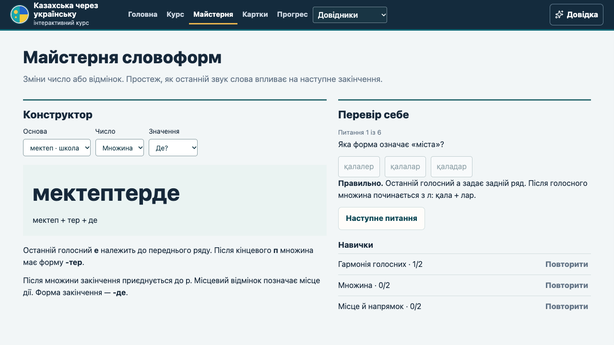

<p align="center">
  
</p>

# Kazakh through Ukrainian

[](https://knspvd98.github.io/kazakh-for-ukrainians/)
[](https://react.dev/)
[](https://www.typescriptlang.org/)

An interactive Kazakh language course designed for Ukrainian-speaking learners. It combines detailed Ukrainian explanations with practical Kazakh examples, dialogues, grammar references, instant-feedback exercises, flashcards, and pre-generated audio.

**Live course:** [knspvd98.github.io/kazakh-for-ukrainians](https://knspvd98.github.io/kazakh-for-ukrainians/)

## Course content

| Area | Content |
| --- | --- |
| Course | 52 sequential lessons from A0 to the A2/B1 bridge |
| Grammar | 35 detailed reference articles with tables, examples, and common mistakes |
| Tables | 12 concise reference tables for suffix and ending patterns |
| Vocabulary | 236 dictionary-form entries with Ukrainian translations and examples |
| Phrasebook | 422 everyday phrases and reusable dialogue patterns |
| Exercises | 1,082 reviewed interactive tasks |
| Audio | More than 1,500 unique Kazakh words and phrases in normal and slow versions |

## Word workshop and offline study

In **Майстерня**, change the noun, number and case to see how a word is formed. Six short questions explain why a suffix fits and record which skill to practise next. In lessons, returning to the course saves your place. Completing a lesson requires the marked reading sections and at least 80% correct across its required practice.



After the first online visit to the production build, lessons and the workshop can reopen offline. To download the audio library, select **Довідники → Аудіо / Дыбыс → Зберегти аудіо** while online. Interrupted downloads resume at the last completed pack. Export progress from **Прогрес** before clearing browser data or switching devices.

## Key features

- A continuous lesson player that keeps explanations, examples, dialogues, and practice in one learning flow.
- Detailed Ukrainian explanations supported by substantial Kazakh input.
- Integrated grammar tables, morpheme breakdowns, visual explanations, and lesson-specific illustrations.
- Exercises for recognition, sentence building, error correction, listening, and dialogue completion.
- Dedicated grammar, ending-table, vocabulary, and phrasebook references.
- Flashcard modes for reviewing completed material and studying vocabulary independently.
- Local progress, difficult-word tracking, and exercise results stored in the browser.
- Pre-generated offline audio with no browser speech synthesis.
- Responsive desktop and mobile layouts.
- Built-in course data quality reporting.

## Technology

- React 19
- TypeScript in strict mode
- Vite 6
- Lucide React
- Local TypeScript datasets with no required backend
- Edge TTS for pre-generating audio assets
- Vitest and Testing Library for unit and component tests
- ESLint with TypeScript and React Hooks rules

## Getting started

Requirements: Node.js 20+ and npm 10+.

```bash
git clone https://github.com/knspvd98/kazakh-for-ukrainians.git
cd kazakh-for-ukrainians
npm ci
npm run dev
```

The local development server is available at `http://127.0.0.1:5173/kazakh-for-ukrainians/`.

## Available commands

| Command | Purpose |
| --- | --- |
| `npm run dev` | Start the local development server |
| `npm run build` | Run TypeScript checks and create a production build |
| `npm run preview` | Preview the production build locally |
| `npm run lint` | Run strict TypeScript and React linting |
| `npm run test` | Run unit and component tests |
| `npm run qa` | Validate the structure and quality of course data |
| `npm run audio:check` | Verify that all required MP3 files exist and are valid |
| `npm run audio:estimate` | Estimate the size of the audio corpus |
| `npm run audio:generate` | Generate missing MP3 files at two speaking rates |
| `npm run check` | Run the complete release validation |

## Project structure

```text
src/
  app/          Application entry point and routing
  components/   Lesson player, exercises, references, progress, and QA
  data/         Lessons, grammar, tables, vocabulary, phrases, and exercises
  styles/       Design tokens and page-level styles
  types/        TypeScript course models
public/audio/   Static audio in normal and slow versions
scripts/        Audio generation and corpus validation
server/         Optional Node server and TTS endpoint
```

## Audio

The interface plays pre-generated MP3 files from `public/audio/v1`. Browser speech synthesis is not used. Audio controls are shown only for complete Kazakh words, sentences, and phrases, not for isolated suffixes or Ukrainian explanations.

Generate and verify new audio files with:

```bash
npm run audio:generate
npm run audio:check
```

The primary voice is `kk-KZ-AigulNeural`. Set `COURSE_ENABLE_TTS=true` to enable local synthesis. The optional Node endpoint supports Edge TTS with file caching and SpeechGen as a fallback provider. Configuration examples are documented in `.env.example`; secrets are never included in the frontend or committed to Git.

## Quality assurance

`npm run qa` validates lesson completeness, exercise and dialogue uniqueness,
dictionary forms, example translations, bilingual table titles, public-content
safety, and audio eligibility. Unit tests cover text classification, persistent
audio settings, and interactive exercise behaviour. ESLint checks TypeScript,
React Hooks, and stale code.

Continuous integration runs:

```bash
npm ci
npm run check
```

The production build uses WebP illustrations, lazy lesson-image loading, and
separate vendor, lesson, practice, and reference chunks. This keeps the full
visual asset set compact without removing offline course content.

## GitHub Pages deployment

The production site is hosted on **GitHub Pages** at:

**https://knspvd98.github.io/kazakh-for-ukrainians/**

Changes to `main` pass the release checks before GitHub Pages publishes the verified build. The same checks run on pull requests. Before uploading, a browser reviews a card, reloads its schedule and restores a progress backup in a fresh session. To run this check locally, build the course, install Chromium with `npx playwright install chromium`, then run `npm run test:browser`. Vite is configured with the repository base path `/kazakh-for-ukrainians/`.

To build for a different public path:

```bash
BASE_PATH=/your-path/ npm run build
```

## Progress and privacy

Learning progress is stored only in the learner's browser using local storage and an IndexedDB backup. The application does not send lesson results to an external server.

## Contributing

Development guidelines are available in [CONTRIBUTING.md](./CONTRIBUTING.md). Run `npm run check` before opening a pull request.

## License

The project and its educational materials are protected by copyright. See [LICENSE](./LICENSE) for details.
